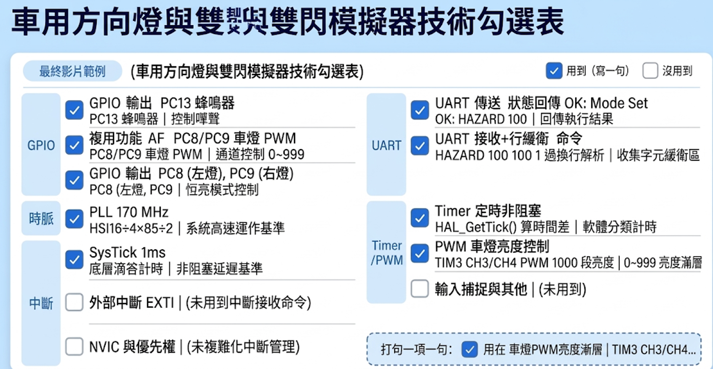
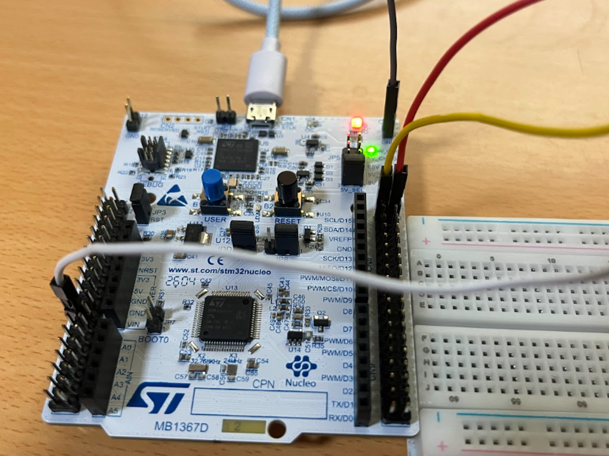
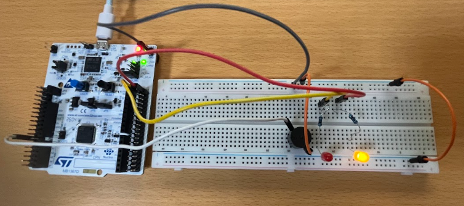
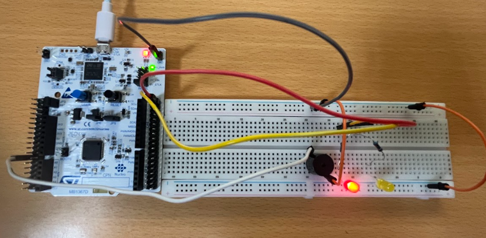
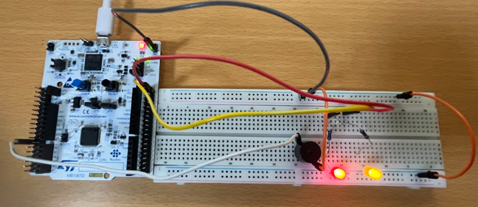
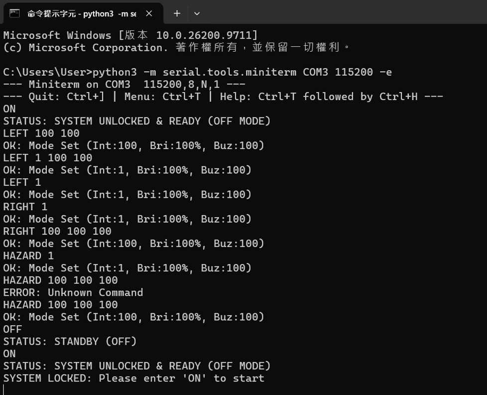

# negus
# 車用方向燈與雙閃警示燈模擬器（ NUCLEO-G474RE 期中專題）
## 1. 情境故事：誰、在哪、遇到什麼麻煩
台灣三寶總是突然殺出，且三寶具有趨光性，因此看見方向燈會因為本能反應而加速衝來。為了抑制住三寶的趨光性，可以透過控制方向燈的亮度以及加入蜂鳴器，達到抑制住趨光性這種本能反應。
## 2. 替身對照：故事裡的模組 → 板上替身
- 車輛左右轉燈->燈泡pc8與pc9
  駕駛艙控制面板、方向燈撥桿->LPUART1傳輸介面
## 3. 功能與驗收條件：動作、預期、實測結果
  1. 動作：輸入 LEFT 100 100 100 
  預測：從滅到亮再到滅是20秒，第二個100是最大亮度，第三個100是蜂鳴器工作週期100ms
  實驗結果：正確達標。
  2. 動作：輸入 RIGHT 100 100  
  預測：從滅到亮再到滅是20秒，第二個100是最大亮度，第三個未填數值，因此自動填入蜂鳴器工作週期500ms
  實驗結果：正確達標。
  3. 動作：輸入 HZAED 100 100 100 
  預測：兩顆燈泡從滅到亮再到滅是20秒，第二個100是最大亮度，第三個100是蜂鳴器工作週期100ms
  實驗結果：正確達標。
## 4. 用到的技術：第 3 ～ 7 週勾選表（同投影片）

## 5. 腳位表：用到的每支腳與用途
  1. PC13->控制蜂鳴器工作週期輸出腳
  2. PC8 TIM3(CH3)->PWM控制除頻與燈泡閃爍時間
  3. PC9 TIM3(CH4)->PWM控制除頻與燈泡閃爍時間
  4. PA2->LPUART1_RX(接收電腦傳進來的指令)
  5. PA3->LPUART1TX(傳送狀態訊息回電腦)
## 6. 建置與執行：開發環境、燒錄步驟、終端機設定、命令
  1. 開發環境：STM32CubeIDE
  2. 燒入步驟：
  使用 Micro-USB 或 USB-C 傳輸線，將 STM32 開發板連接至電腦，確認板子上的 ST-LINK 燈號亮起，代表供電與通訊正常。
  在 STM32CubeIDE 中打開本專案，點擊上方工具列的(Build)。
  點擊上方工具列的 Run完成燒入。
  3. 終端機設定：Baud Rate (鮑率)：115200、Data Bits (資料位元)：8、Stop Bits (停止位元)：1、Parity (同位檢查)：None。
  4. 命令：燒入後輸入ON啟動程式->輸入指令->繼續輸入指令->輸入OFF關閉系統需等待下次輸入ON重新開啟，若按RESET則系統重啟後須輸入ON啟動程式。
## 7. 程式結構：哪個檔做什麼、 ISR 與主迴圈分工
  1. 程式檔案分工
  main.h：「標頭檔與全域宣告區」用來引入 STM32 HAL 庫（stm32g4xx_hal.h 等）。定義硬體腳位對照、巨集（Macro）與全域函式原型宣告。
  main.c：main() 函式：系統開機初始化、硬體外設設定與無限主迴圈 (while(1))。
  初始化函式群：SystemClock_Config()、MX_GPIO_Init()、MX_TIM3_Init() 等。
  2. ISR（中斷服務常式）與主迴圈的分工
  系統時脈中斷 (SysTick_Handler / ISR)是 STM32 內建的系統核心計時中斷（通常每 1 毫秒觸發一次）。累加 HAL_GetTick() 的毫秒數，讓整個系統有了「時間基準。
Main Loop（主迴圈） 負責思考與執行（處理序列埠指令、計算燈光呼吸曲線、控制蜂鳴器節奏）。
## 8. 實作照片：每張附一行圖說

    紅線是PC8(控制左轉黃燈)，黃線是PC9(控制右轉紅燈)，白線是PC13(控制蜂鳴器工作週期，最後右上角黑線是GND)

    左轉黃燈

   右轉紅燈

   雙閃燈

   終端機輸入指令狀況
